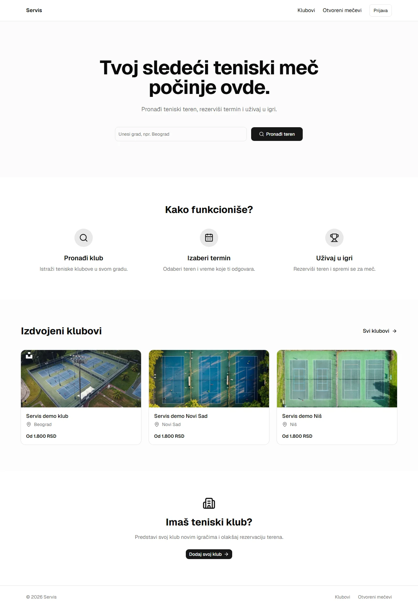
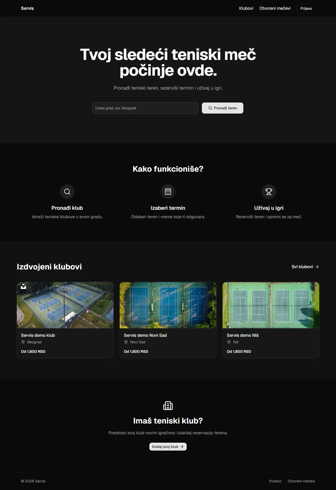
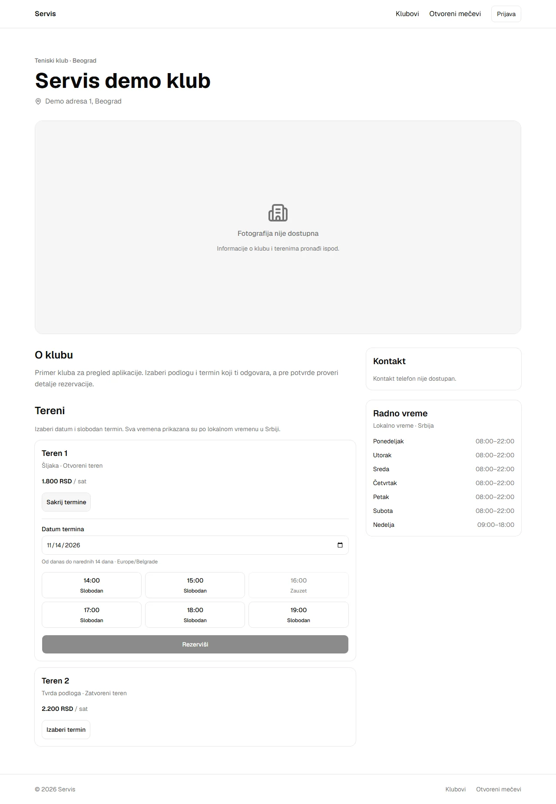
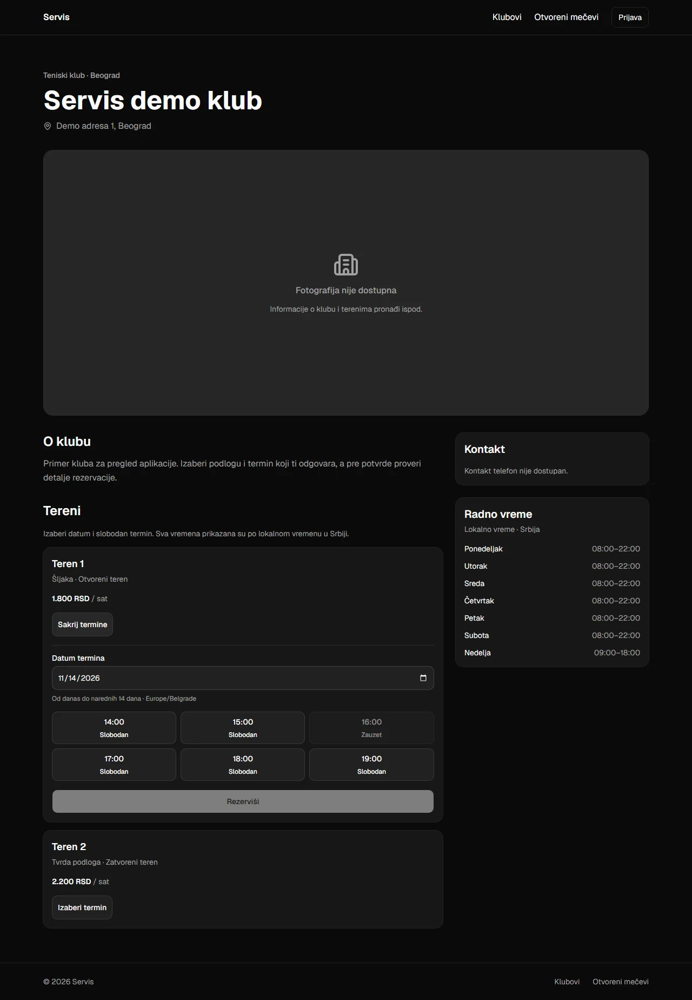
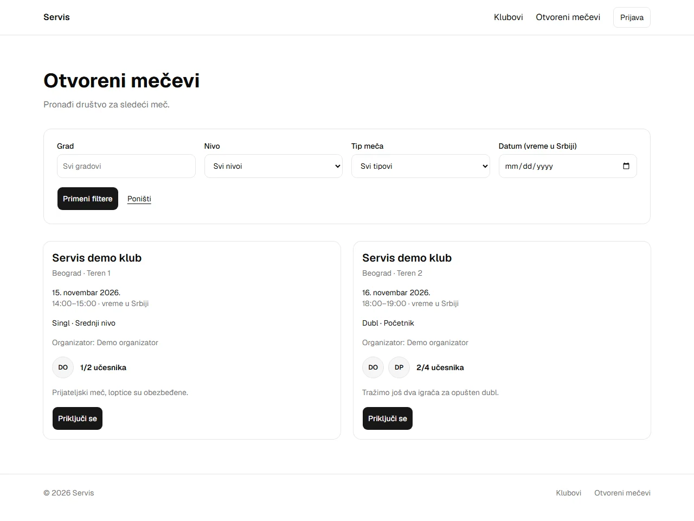
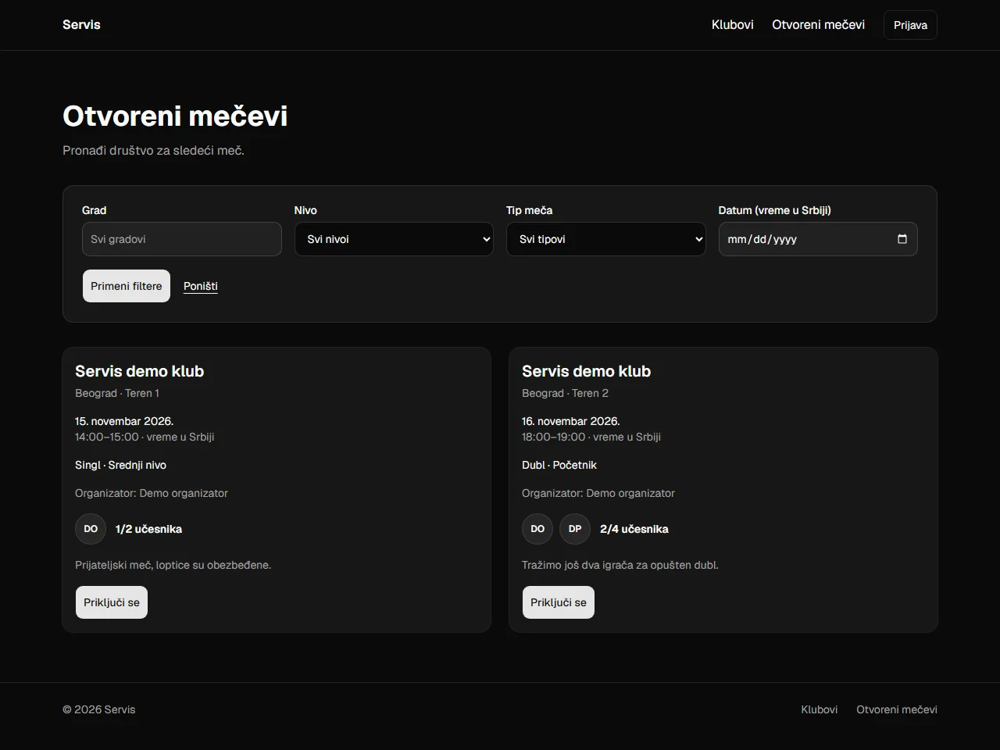
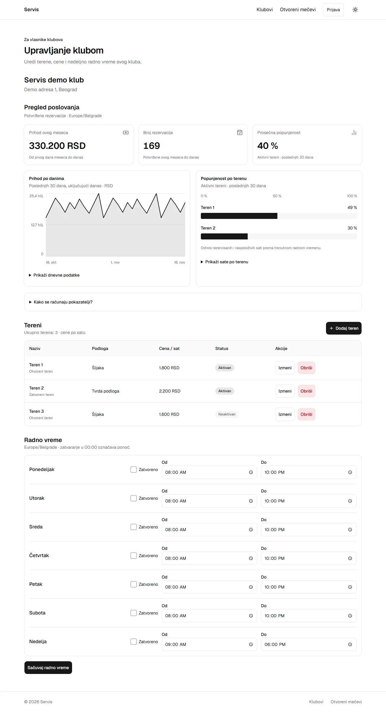
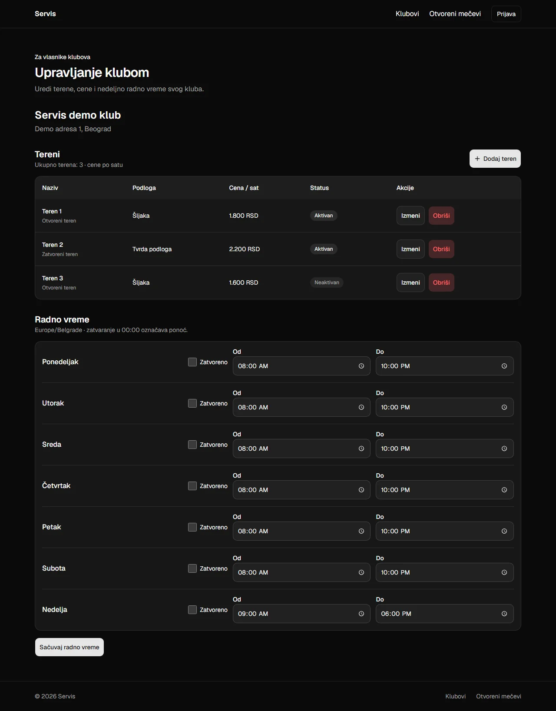
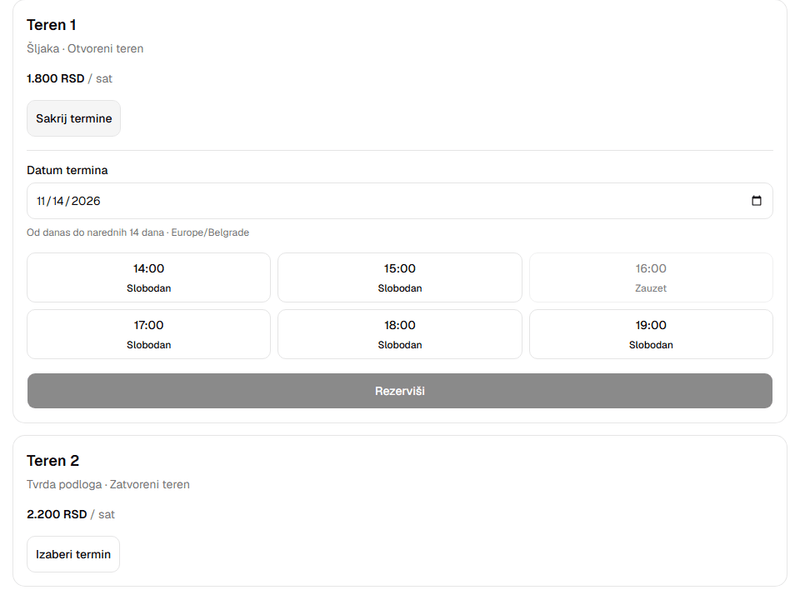

# Servis

Find a tennis court, book a slot and find someone to play with. Servis connects players with tennis clubs in Serbia and gives club owners tools to manage their courts.

**Live demo: Coming soon.** No verified public deployment is available for this showcase.

[Screenshots](#screenshots) · [Booking walkthrough](#booking-walkthrough) · [Local setup](#local-setup) · [Demo accounts](#demo-accounts) · [How we used AI](#how-we-used-ai)

The app UI and URLs use Serbian (Latin script). Code, documentation and Git history use English. Prices are in RSD; booking times use **Europe/Belgrade**.

## Features

- **Find a club:** filter by city, court surface and maximum hourly price, with shareable URLs and pagination. View club details, gallery or photo fallback, opening hours and active courts.
- **Book a court:** choose a date from today through the next 14 days, select a free one-hour slot and confirm the details. Booked and past slots are disabled; availability refreshes after confirmation or a conflict. Server validation and a database exclusion constraint prevent overlapping bookings.
- **Manage bookings:** view upcoming and past reservations, cancel at least 24 hours before the start and publish a future confirmed reservation as an open match.
- **Find partners:** filter open matches by city, level, singles/doubles and date. Join or leave with optimistic feedback. Full matches disappear from public search but remain visible to their participants.
- **Manage a club:** owners can switch between their clubs, add or edit courts, set prices and active status, and configure all seven days of opening hours. Courts with booking history can be deactivated instead of deleted.
- **Sign in:** email/password authentication, optional Google sign-in, player/owner roles and server-side access checks.
- **Use on mobile:** responsive layouts, light/dark styling, loading, empty and error states.

### Work awaiting review

These open PRs are separate from the `main` snapshot shown below. Their implementations are not included in this documentation branch.

| PR                                                           | Pending addition                                                                          |
| ------------------------------------------------------------ | ----------------------------------------------------------------------------------------- |
| [#57](https://github.com/filipvicentijevic99/servis/pull/57) | Owner revenue/occupancy KPIs and accessible SVG charts                                    |
| [#58](https://github.com/filipvicentijevic99/servis/pull/58) | Booking confirmation/cancellation email templates and preview; sending is a separate task |
| [#59](https://github.com/filipvicentijevic99/servis/pull/59) | Shared empty states, global error/404 recovery and loading polish                         |
| [#60](https://github.com/filipvicentijevic99/servis/pull/60) | Persistent Light / Dark / System selector and mobile/contrast fixes                       |

## Screenshots

Actual application pages rendered in Chrome from `main` at `4a096a7`, with **isolated showcase fixtures**, not live customer data. Both themes use the existing app styles; dark mode was applied by the capture harness because the theme selector is still in PR #60. The dashboard shows current court management, without the pending analytics.

The club has no supplied photographs, so its genuine gallery fallback is shown. Home uses the application's existing illustrative court images. [Capture details and asset sizes](docs/showcase/README.md).

### Home

| Light                                                                                                    | Dark                                                                                                   |
| -------------------------------------------------------------------------------------------------------- | ------------------------------------------------------------------------------------------------------ |
|  |  |

### Club and date/slot picker

| Light                                                                                                                             | Dark                                                                                                                            |
| --------------------------------------------------------------------------------------------------------------------------------- | ------------------------------------------------------------------------------------------------------------------------------- |
|  |  |

### Open matches

| Light                                                                                                                             | Dark                                                                                                                            |
| --------------------------------------------------------------------------------------------------------------------------------- | ------------------------------------------------------------------------------------------------------------------------------- |
|  |  |

### Owner dashboard

| Light                                                                                                                          | Dark                                                                                                                         |
| ------------------------------------------------------------------------------------------------------------------------------ | ---------------------------------------------------------------------------------------------------------------------------- |
|  |  |

## Booking walkthrough

Choose a date → select a slot → review club, court, time and price → confirm → see feedback and refreshed availability.



**Isolated UI demonstration:** the real booking picker handles the interactions, while availability and a successful confirmation are supplied by in-memory test adapters. No server booking action runs and no database reservation is created. This GIF demonstrates the UI, not an end-to-end production booking test. Dates are fixed for a repeatable recording.

## Tech stack

| Area             | Tools                                                                                              |
| ---------------- | -------------------------------------------------------------------------------------------------- |
| App              | Next.js 16 App Router, React 19, strict TypeScript, Server Components and Server Actions           |
| UI               | Tailwind CSS 4, shadcn/ui with Base UI, Lucide icons, Sonner notifications                         |
| Forms            | React Hook Form, Zod 4, `zodResolver`                                                              |
| Data             | PostgreSQL (Neon), Prisma 7, PostgreSQL driver adapter                                             |
| Authentication   | Better Auth: email/password, optional Google OAuth, server-validated roles                         |
| Dates and themes | `Intl` with Europe/Belgrade helpers; dark styles and `next-themes` dependency (selector in PR #60) |
| Quality          | Vitest, ESLint, Prettier with the Tailwind plugin, GitHub Actions CI                               |

## Local setup

Use **Node.js 22+**, npm and a **dedicated development PostgreSQL database**. Neon is the project's hosted database option; pooled and direct connection URLs are supported.

1. Clone the repository and create your environment file **before installing dependencies**. The install runs Prisma client generation, which loads the database configuration.

   ```bash
   git clone https://github.com/filipvicentijevic99/servis.git
   cd servis
   cp .env.example .env.local
   ```

   On Windows PowerShell, use `Copy-Item .env.example .env.local` instead of `cp`.

2. Fill in `.env.local` using [`.env.example`](.env.example):

   | Variable                                   | Purpose                                                                                                                |
   | ------------------------------------------ | ---------------------------------------------------------------------------------------------------------------------- |
   | `DATABASE_URL`                             | Application connection to your development database; pooled for Neon                                                   |
   | `DATABASE_URL_UNPOOLED`                    | Direct connection for migrations and seed; falls back to `DATABASE_URL` if omitted                                     |
   | `BETTER_AUTH_SECRET`                       | A private random secret; generate with `node -e "console.log(require('node:crypto').randomBytes(32).toString('hex'))"` |
   | `BETTER_AUTH_URL`                          | `http://localhost:3000` locally                                                                                        |
   | `GOOGLE_CLIENT_ID`, `GOOGLE_CLIENT_SECRET` | Optional; both are required to enable Google sign-in                                                                   |

   For local Google OAuth, register this authorized redirect URI:

   ```text
   http://localhost:3000/api/auth/callback/google
   ```

   Keep real secrets out of Git.

3. Install locked dependencies and apply migrations **only to your own development database**:

   ```bash
   npm ci
   npx prisma migrate dev
   npx prisma generate
   ```

4. Optionally seed your disposable development database, then start the app:

   ```bash
   npm run db:seed
   npm run dev
   ```

   **The seed deletes all existing clubs and bookings and recreates the test users/data. Never run it against a shared or production database.** Skip it if you want to preserve your existing development data.

Open [http://localhost:3000](http://localhost:3000). Browse clubs at `/klubovi`, open matches at `/mecevi`, player bookings at `/igrac/rezervacije` and owner tools at `/dashboard`. Protected pages require the appropriate session/role.

## Demo accounts

These accounts are defined in [`prisma/seed.ts`](prisma/seed.ts) and are available **only after seeding your own development database**. They are not credentials for a public deployment.

| Role       | Email                  | Password     |
| ---------- | ---------------------- | ------------ |
| Club owner | `vlasnik1@servis.test` | `lozinka123` |
| Club owner | `vlasnik2@servis.test` | `lozinka123` |
| Player     | `igrac1@servis.test`   | `lozinka123` |
| Player     | `igrac2@servis.test`   | `lozinka123` |

The seed also creates `igrac3@servis.test` and `igrac4@servis.test` with the same password. Seed bookings use dates relative to the day it runs; the README's fixed showcase dates are independent of them.

## Development checks

| Command                                   | Purpose                                              |
| ----------------------------------------- | ---------------------------------------------------- |
| `npm run dev`                             | Start the development server                         |
| `npm run build`                           | Build for production                                 |
| `npm start`                               | Serve an existing production build                   |
| `npm run lint`                            | Run ESLint                                           |
| `npm run typecheck`                       | Generate Next.js route types and check TypeScript    |
| `npm test`                                | Run the Vitest suite                                 |
| `npm run format` / `npm run format:check` | Write/check Prettier formatting                      |
| `npm run db:seed`                         | Reset test data in a disposable development database |
| `npx prisma studio`                       | Browse the configured database                       |

CI runs lint, typecheck, tests and a production build on pull requests to `main`. Tests use mocks where appropriate; a green suite does not establish that Google OAuth, email delivery or booking against a deployed database has been integration-tested.

## How we work

Tasks are tracked in [GitHub issues](https://github.com/filipvicentijevic99/servis/issues). Each task gets a feature branch and a [pull request](https://github.com/filipvicentijevic99/servis/pulls), with CI and human review before merging. Project conventions and AI instructions live in [CLAUDE.md](CLAUDE.md) and [AGENTS.md](AGENTS.md).

## How we used AI

We used **ChatGPT and Codex** to turn issue requirements into implementation steps, inspect existing code, build UI around established backend contracts, write focused tests, investigate failures and prepare documentation. Codex also helped with Git conflict diagnosis and browser checks. AI suggestions were inputs to the team's work, not independent evidence that a feature was complete.

**People made the decisions:** Filip defined backend contracts and architecture, approved dependency choices and reviewed pull requests. Tijana directed frontend scope and UI work, checked the app manually and controlled when changes were committed or pushed. Review feedback led to follow-up fixes, including preserving a participant's ability to leave a full match and correcting error-boundary props.

**Verification stayed explicit:** changes were checked with formatting, lint, TypeScript, focused/full Vitest runs and production builds as appropriate, followed by browser checks. Tests, manual review and CI catch different problems; AI output still needs human review. Work that required shared-database writes was not treated as tested when no isolated test database was available. This showcase uses isolated data and labels its simulated confirmation rather than presenting it as a real booking.

## Team

- [Filip Vicentijević](https://github.com/filipvicentijevic99) — architecture, backend and code review.
- [Tijana Đuknić](https://github.com/tijana333) — frontend, UI and manual review.
